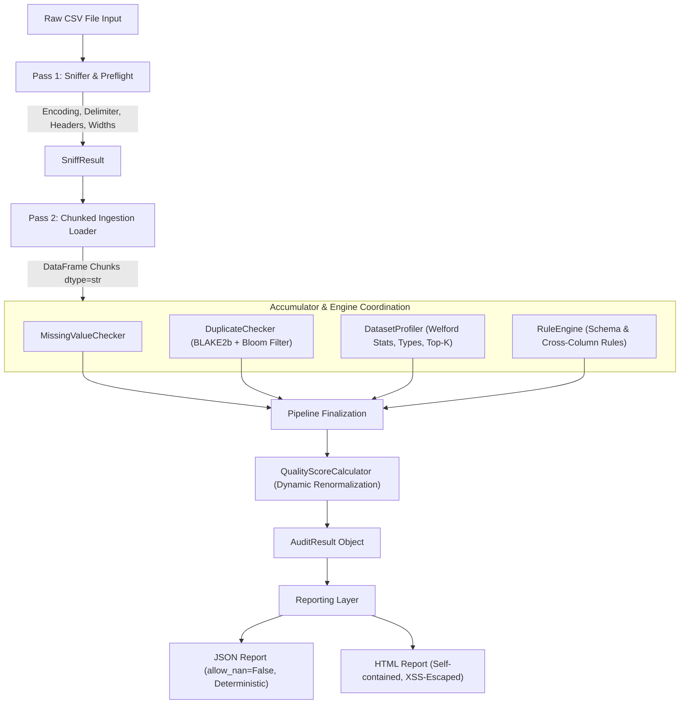

# System Architecture

`csv-auditor` is an single-process streaming CSV data quality auditor with chunked parsing and capped in-memory tracking structures.



## Key Architectural Principles

### 1. Two-Pass Processing Pipeline (D3)
- **Pass 1 (Preflight Inspection):** Scans the initial file slice (up to 256 KB) to attempt to detect character encoding (handling UTF-8, UTF-8-BOM, UTF-16, Windows-1252), field separators (comma, semicolon, tab, pipe), header structure, and row-width consistency.
- **Pass 2 (Streaming Execution):** Iterates across the entire dataset in memory-bounded batches (default chunk size: 50,000 rows). Chunks are built from `csv.reader` records as strings to prevent premature type coercion and preserve data integrity.

### 2. Stream Accumulator Model (D4)
All analysis engines conform to a stateful accumulator protocol:
```python
class Accumulator(Protocol):
    def update(self, chunk: pd.DataFrame) -> None: ...
    def finalize(self) -> dict[str, Any]: ...
```
Only bounded chunks, samples and duplicate-tracking hashes are retained in memory. Incremental statistics (such as mean and variance) are calculated via the numerically stable Welford algorithm.

### 3. Dual-Stage Duplicate Tracking (D5)
- Each row is encoded as length-prefixed UTF-8 fields and hashed with 128-bit BLAKE2b. Length prefixes stop `["a,b", "c"]` and `["a", "b,c"]` from producing the same input.
- Digested hashes are tracked in a hash set up to the `max_tracked_rows` config setting.
- If dataset scale exceeds tracking boundaries, the system automatically transitions into a bit-packed Bloom filter, maintaining constant sub-linear memory overhead while transparently tagging duplicate reporting mode as `"approximate"`.

### 4. Schema Isolation and Advisory Inference (D2)
Type inference is decoupled from data ingestion. User-defined configuration schemas strictly take precedence. Inferred types are advisory indicators that compute dominant-type share metrics for the consistency score without altering underlying raw values.
